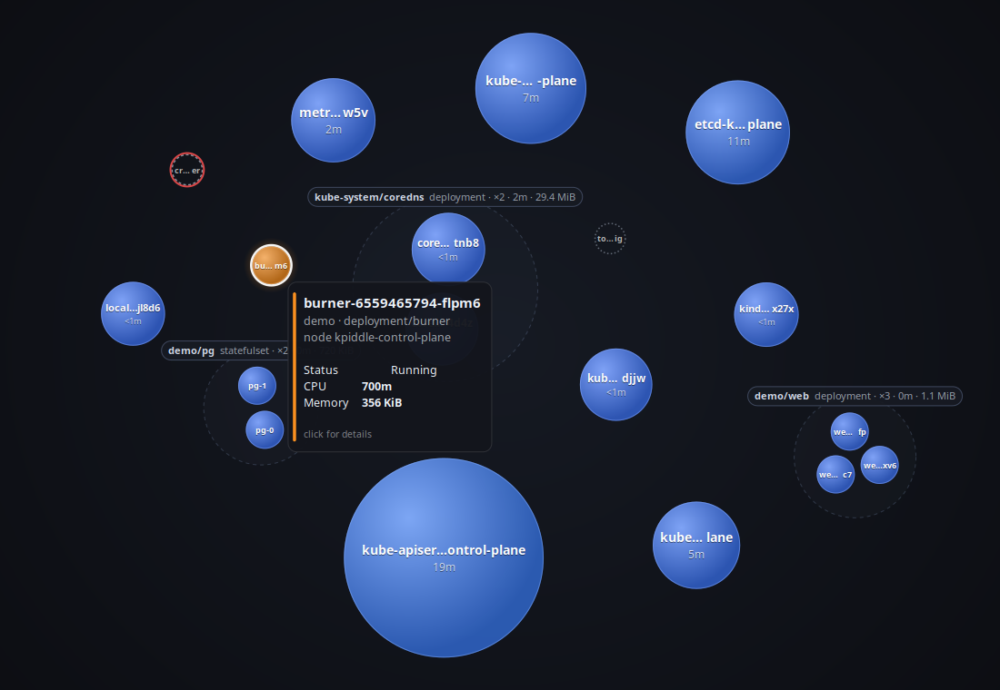
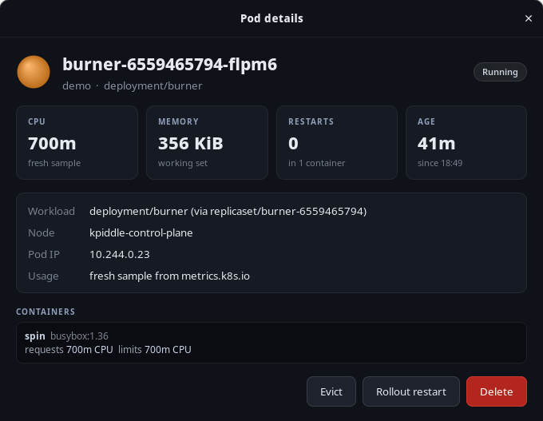
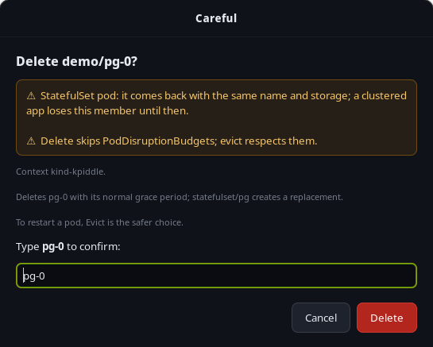

# kpiddle changelog

Notable changes in each kpiddle release. The section for a version is
published as its release notes, and a release fails if it is missing.

## [Unreleased]

### Changed
- kpiddle-gui's details window and type-the-name confirmation now use
  piddle-common 0.1.1's shared `piddle_gtk::details`, like PIDdle's. No
  visible change.
- `scripts/use-local-common.sh off` restores Cargo.lock to the pinned
  piddle-common commit, so a lockfile changed while patched can be
  committed as is.
- `scripts/use-local-common.sh` manages only its own marked block in
  `.cargo/config.toml` instead of overwriting or deleting the whole file,
  and refuses to add a second piddle-common patch table. A config written
  by its old version is taken over only if nothing was added to it since.

## [0.2.0] - 2026-11-01

The graphical interface can now show a pod's details and, when started with
`--allow-actions`, evict, restart or delete it, with the terminal
interface's safety rules. Both interfaces are now packaged for Debian,
Fedora and Arch, and published in a signed package repository.

### Added
- kpiddle-gui: click a pod to open its details window: status, CPU and
  memory (with the sample's freshness, and memory against its limit when
  every container sets one), restarts, age, the owner chain, node, IP, and
  each container's image, requests, limits and restarts. The window follows
  the pod by UID and says when it's gone.
- kpiddle-gui `--allow-actions`: Evict, Rollout restart and Delete buttons
  in the details window, with the TUI's safety rules. A refused action is
  disabled with the reason, a risky one needs the name typed, and the rest
  ask in a dialog that defaults to Cancel. Failures, such as a
  PodDisruptionBudget refusal, are shown in the window and in a dialog. The
  banner says whether actions are on.
- Packages for x86_64 and ARM64: `kpiddle` (the static terminal interface)
  and `kpiddle-gui` (the GTK interface with a menu entry), as .deb, .rpm
  and Arch packages. Each installs on its own; neither requires the other.
  The static `kpiddle` tarballs are still published.
- A signed package repository on GitHub Pages,
  <https://scott-hiemstra.github.io/kpiddle/>, for apt, dnf and pacman,
  updated by each release.

### Changed
- A static pod's owner reads "a static pod, run by the kubelet on NODE"
  instead of calling it a bare pod.
- A rollout restart of a one-pod workload says "Replaces the only pod",
  not "all 1 pod".

## [0.1.0] - 2026-11-01

First release: a terminal view of a Kubernetes cluster's pods by CPU and
memory, in the PIDdle style. It only reads unless started with
`--allow-actions`.

### Added
- Pods grouped by namespace and workload (Deployment, StatefulSet,
  DaemonSet, CronJob and so on, resolved through ReplicaSets and Jobs), or
  as a flat list; sort by CPU, memory or name; search; collapsible groups.
- A details popup: status and restarts, usage and its freshness, the owner
  chain, node, IP, age, and each container's image, requests, limits and
  restarts.
- Usage from metrics.k8s.io (metrics-server), polled every 15 s. Missing or
  stale metrics never look like zero usage:
  - a pod without a sample shows `—` and sorts after measured pods;
  - stale values are dimmed and carry their age;
  - totals over partly measured groups are marked `≥` with their coverage
    (`7/10 eligible pods measured`); pending and finished pods
    have no usage, so they don't count against coverage and are listed as
    not running;
  - the header always shows the metrics state: OK, stale since when, or
    unavailable with the reason.
- `--context` and `--namespace` like kubectl; all namespaces by default.
- `--once` prints a plain listing for scripts.
- Actions, only with `--allow-actions` (the header then says *actions on*),
  from the list or the details popup:
  - `e` evicts a pod through the eviction API, so PodDisruptionBudgets are
    respected. A budget's refusal is shown as such and not retried.
  - `r` rollout-restarts the pod's Deployment, StatefulSet or DaemonSet.
  - `d` deletes a pod, bypassing budgets.
  - Each asks first: yes/no defaulting to no, or typing the name for
    deletes and for pods in `kube-system`, control-plane pods, pods with no
    controller (removing them is permanent) and StatefulSet pods. Static
    pods are refused, since removing one through the API doesn't stop it.
  - Evict and delete only act on the exact pod that was confirmed: if a pod
    with the same name has replaced it (a StatefulSet member), nothing is
    done and kpiddle says so.
  - Forbidden (403) and other API errors are shown in full.
- Pod names, images, reasons and API errors are sanitized before display.
- `kpiddle-gui`, a first graphical interface (GTK 4, build from source; not
  in the release tarballs yet): pods as bubbles sized by memory and colored
  by CPU, grouped by workload, namespace or node, with search and a hover
  card. Pods without a usage sample are hollow gray rings, stale ones are
  dimmed, pods in trouble get a red outline, and group labels carry `≥`
  and coverage like the terminal view. It shares PIDdle's bubble engine.
